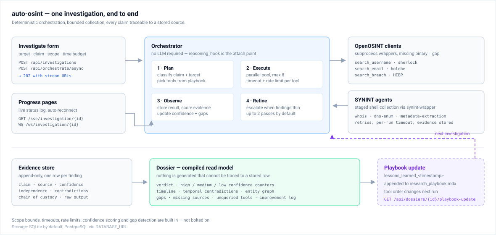

<div align="center">

# auto-osint

**Agentic recursive OSINT research with data-journalism rigor.**

[](https://github.com/datamathcode/auto-osint/actions/workflows/test.yml)
[](https://github.com/datamathcode/auto-osint/releases)
[](pyproject.toml)
[](package.json)
[](LICENSE)

[Overview](#overview) • [Quick start](#quick-start) • [How it works](#how-it-works) • [Project status](#project-status) • [API](#api) • [Development](#development) • [Deployment](#deployment)

</div>

> [!WARNING]
> **Responsible use.** This tool automates open-source collection. You are responsible for complying with platform terms of service and the law. Read [docs/legal.md](docs/legal.md) before your first investigation. Do not use it to profile private individuals, minors, or anyone you are not entitled to investigate.

## Overview

auto-osint takes one claim about a public figure, company, or domain and runs a bounded investigation. It plans the work, queries OSINT tools, stores each finding with its source, and compiles a dossier: verdict, confidence counters, timeline, entity graph, and gaps.

Three commitments shape the design:

- **Traceable output.** Every dossier section reads from stored evidence rows. Nothing is generated that cannot be traced back to a source.
- **Bounded collection.** Scope, per-tool timeouts, rate limits, and a concurrency cap limit what a run can do.
- **Honest weakness.** Missing sources, unanswered questions, and failed tools are reported as gaps, not smoothed over.



## Quick start

### Prerequisites

| Need | Version | Why |
|---|---|---|
| Python | 3.10+ | API, agents, orchestrator |
| Node.js | 18+ | Next.js frontend |
| SQLite | bundled with Python | Default local database |
| PostgreSQL | 14+ | Optional production database |
| `sherlock`, `holehe` | latest | Username and email clients (optional) |
| SYNINT | your build | Shell agents (optional) |
| HIBP API key | any paid tier | Breach lookups (optional) |

Missing optional tools do not stop a run. The dossier reports them as gaps.

### 1. Install the backend

```bash
git clone https://github.com/datamathcode/auto-osint.git
cd auto-osint
python3 -m venv .venv && source .venv/bin/activate
pip install -e ".[dev]"
```

### 2. Create the environment file

```bash
cp .env.example .env
```

The defaults use a local SQLite file. Leave the API keys blank for a first run.

> [!NOTE]
> Without `HIBP_API_KEY`, breach lookups are skipped and reported as gaps. The UI shows a banner when the key is missing.

### 3. Create the database

```bash
python -m src.python.scripts.setup_database
```

This command is idempotent. Run it again after a schema change.

### 4. Install the frontend

```bash
npm install
```

### 5. Run both services

Use two terminals.

```bash
# terminal 1 — API on :8000
python -m src.python.main

# terminal 2 — UI on :3000
npm run dev:frontend
```

Open <http://localhost:3000/investigate>. Enter a target and a claim, then press **Start investigation**.

> [!TIP]
> The root page is a placeholder. Start at `/investigate`, and open `/dossiers/{id}` when a run completes.

### Verify the installation

```bash
./scripts/verify-installation.sh
```

The script checks Python, imports, the playbook file, the database schema, Node, and optional tools. It exits non-zero on a hard failure.

### Run one agent from the CLI

```bash
synint-wrapper --synint-path ./path/to/synint --agent WhoisAgent \
  --target example.com --investigation-id 1
```

Or use a wrapper script: `scripts/agents/whois-agent.sh example.com`.

## How it works

Every run moves through four steps. The loop is deterministic by default. `reasoning_hook` in `src/python/orchestrator.py` is where an LLM can attach.

| Step | What happens |
|---|---|
| **Plan** | Classify the claim and the target. Pick tools from the research playbook. |
| **Execute** | Run the tools in a thread pool. Default cap: 8 concurrent calls, 60 s per tool. |
| **Observe** | Store each result as an evidence row with source, confidence, and chain of custody. |
| **Refine** | Escalate when findings are thin. Default: up to 2 passes. |

Runs are resumable. Send `resume: true` to `/api/orchestrate` and the orchestrator skips tools that already completed.

### Confidence and verdicts

Each finding carries a score and an independence score. The dossier maps the net score to a verdict:

| Net score | Verdict |
|---|---|
| `>= 0.7` | supported |
| `0.4 – 0.7` | inconclusive |
| `< 0.4` | unsupported |

> [!IMPORTANT]
> The current release scores evidence with a fixed heuristic: `0.6` for a successful tool result and `0.3` for a failure. The Bayesian posterior and independence tests are designed in [the design document](docs/superpowers/specs/2026-11-12-auto-osint-design.md) and stubbed in `src/python/confidence_quantization.py`. Treat scores as a ranking aid, not a probability.

### Dossier sections

| Section | Source |
|---|---|
| **Evidence** | Every evidence row for the run, with links and chain of custody |
| **Counter-evidence** | Evidence rows that carry contradiction IDs |
| **Timeline** | Dates and roles extracted from evidence and custody entries |
| **Entity network** | Entities and relationships with degree and betweenness metrics |
| **Gaps** | Missing source types, unanswered questions, unqueried tools, single-source bias |
| **Improvement log** | The lesson appended to the playbook after the run |

### Learning loop

When a run completes, `run_post_investigation` appends a dated `lessons_learned_<timestamp>` record to `src/python/research_playbook.mdx`. The next investigation reads those lessons and moves tools that worked for that claim type to the front of the plan.

## Project status

This is a working MVP, not a finished product. The table states what runs today.

| Component | State | Notes |
|---|---|---|
| Orchestration loop | **Implemented** | Plan, execute, observe, refine |
| Evidence store | **Implemented** | SQLite by default, PostgreSQL supported |
| Chain of custody | **Implemented** | Append-only JSON log per evidence row |
| Gap audit | **Implemented** | Missing sources, unanswered questions, bias check |
| Timeline | **Implemented** | Four event roles, contradiction hints |
| Entity graph | **Implemented** | Heuristic entity extraction, degree and betweenness |
| Playbook learning | **Implemented** | Lessons appended, tool order updated |
| Progress streaming | **Implemented** | SSE and WebSocket, heartbeat, 50-event replay |
| OpenOSINT clients | **Partial** | 3 clients: username, email, breach |
| SYNINT integration | **Partial** | Wrapper CLI plus 3 agent scripts |
| Bayesian confidence | **Placeholder** | Fixed 0.6 / 0.3 heuristic today |
| Contradiction detection | **Partial** | Agents may set contradiction IDs; the pipeline does not detect them |
| Authentication | **Not implemented** | Single-user, local-first |
| Landing page | **Placeholder** | Use `/investigate` |

> [!CAUTION]
> The API has no authentication and allows all origins. Do not expose port 8000 to the public internet as is.

## Configuration

Full reference: [docs/configuration.md](docs/configuration.md). The API never returns secret values; `GET /api/config/defaults` reports presence only.

| Variable | Default | Purpose |
|---|---|---|
| `DATABASE_URL` | `sqlite:///./data/auto_osint.db` | Database connection |
| `LLM_PROVIDER` | `anthropic` | `anthropic`, `openai`, or `ollama` |
| `ANTHROPIC_API_KEY` | unset | Provider key, optional |
| `OPENAI_API_KEY` | unset | Provider key, optional |
| `OLLAMA_BASE_URL` | `http://localhost:11434` | Local model endpoint |
| `HIBP_API_KEY` | unset | Breach lookups |
| `SYNINT_PATH` | `synint` | SYNINT binary |
| `MAX_EXECUTION_TIME` | `3600` | Seconds per investigation |
| `TIMEOUT_PER_TOOL` | `60` | Seconds per tool call |
| `MAX_CONCURRENT_QUERIES` | `8` | Parallel tool calls |
| `NEXT_PUBLIC_API_URL` | `http://localhost:8000` | Frontend → API base URL |

Never commit `.env`.

## API

Interactive documentation is at <http://localhost:8000/docs> when the API runs.

| Method | Path | Purpose |
|---|---|---|
| `POST` / `GET` | `/api/investigations` | Create or list investigations |
| `GET` / `PATCH` | `/api/investigations/{id}` | Read or update one investigation |
| `GET` | `/api/investigations/{id}/evidence` | Evidence for one run |
| `POST` | `/api/orchestrate` | Run synchronously, with optional `resume` |
| `POST` | `/api/orchestrate/async` | Start in the background, returns `202` and stream URLs |
| `GET` | `/api/dossiers/{id}` | Full dossier |
| `GET` | `/api/dossiers/{id}/evidence` | Paginated evidence |
| `GET` | `/api/dossiers/{id}/timeline` | Timeline events |
| `GET` | `/api/dossiers/{id}/graph` | Entity graph |
| `GET` | `/api/dossiers/{id}/gaps` | Gap report |
| `GET` | `/api/dossiers/{id}/playbook-update` | Latest lesson |
| `GET` | `/api/evidence`, `/api/results` | Query by target or tool |
| `GET` | `/api/timeline/{id}`, `/api/graph/{id}`, `/api/audit/{id}` | Visualisation and audit data |
| `GET` | `/api/config/defaults` | Non-secret defaults |
| `GET` | `/health` | Liveness check |
| `GET` | `/sse/investigation/{id}` | Server-Sent Events stream |
| `WS` | `/ws/investigation/{id}` | WebSocket stream |

Progress events: `investigation_started`, `plan_generated`, `step_started`, `finding`, `step_finished`, `confidence_updated`, `refinement`, `investigation_complete`.

## Development

```bash
ruff check src/python/ tests/     # lint
python -m pytest tests/ -q        # 222 tests
npx tsc --noEmit                  # type check
npm run build                     # production build
```

The test suite runs against temporary SQLite databases and stubs external tools. No network access is needed.

CI covers tests on Python 3.10 and 3.11, lint, build, a security scan, and a PR review checklist. The deploy workflow stays disabled until a staging host exists.

Branches: `feature/<ticket>-<slug>` → `develop` → `main`. See [BRANCHING.md](BRANCHING.md) and [CONTRIBUTING.md](CONTRIBUTING.md).

## Deployment

### Cloudflare Workers

The frontend runs on Cloudflare Workers through the OpenNext adapter, pinned to
`@opennextjs/cloudflare@1.15.0` — the last release that supports Next 14.

```bash
npm run preview   # build, then serve the Worker locally on :8787
npm run deploy    # build, then deploy (needs `npx wrangler login` once)
```

`wrangler.jsonc` holds the Worker name, the asset binding and `API_BASE_URL`.
Point `API_BASE_URL` at the API origin; the dossier page fetches it at request
time on the server.

The API sits behind Cloudflare Access, so the Worker carries a service token:

```bash
npx wrangler secret put CF_ACCESS_CLIENT_ID
npx wrangler secret put CF_ACCESS_CLIENT_SECRET
```

Server components call the API directly with those headers. Browser pages call
`/api/proxy/...` on the same Worker; `app/api/proxy/[...path]/route.ts` forwards
the request and adds the token, so the credential never reaches the client.

The progress page uses SSE (`/api/proxy/sse/investigation/{id}`), not WebSocket:
a Worker cannot upgrade a socket without a Durable Object.

Live deployment: <https://auto-osint.dmc-297.workers.dev>

The Worker is built with `nodejs_compat` and no incremental cache: every page is
either static or `no-store`, so R2 and KV would add setup without changing
behaviour.

### Docker Compose

Requires Docker Engine with the Compose v2 plugin (`docker compose version`).

```bash
cp .env.example .env                                 # optional: LLM and OSINT keys
export POSTGRES_PASSWORD="$(openssl rand -hex 16)"   # required
docker compose up --build
```

| Service | Port | Notes |
|---|---|---|
| `db` | internal | PostgreSQL 16; data kept in the `db_data` volume |
| `api` | 8000 | FastAPI; waits for a healthy database; `/health` every 30 s |
| `web` | 3000 | Next.js; starts once the API reports healthy |

Open <http://localhost:3000/investigate>. Check the API directly with
`curl http://localhost:8000/health`.

`NEXT_PUBLIC_API_URL` is compiled into the frontend at build time. Set it before
building when the API is not at `localhost:8000`:

```bash
NEXT_PUBLIC_API_URL=https://api.example.com docker compose build web
```

Stop the stack with `docker compose down`; add `-v` to delete the database
volume too. The images are built from the local tree — no registry image is
published.

The API image also runs without Compose and without PostgreSQL: it falls back to
SQLite on the `/data` volume.

```bash
docker build -t auto-osint-api .
docker run -p 8000:8000 -v auto_osint_data:/data auto-osint-api
```

### Vercel

`vercel.json` builds the frontend only. Set `NEXT_PUBLIC_API_URL` to the public API URL in the project settings. Host the API separately, with authentication in front of it.

## Troubleshooting

| Symptom | Cause | Fix |
|---|---|---|
| `No module named 'src'` | Wrong working directory | Run commands from the repository root |
| `No module named 'httpx'` | Dev extras missing | `pip install -e ".[dev]"` |
| `No module named 'pytest'` | Dev extras missing | Same command as above |
| Dossier shows "Could not load this dossier" | API down or wrong URL | Check `/health` and `NEXT_PUBLIC_API_URL` |
| Breach lookups skipped | `HIBP_API_KEY` unset | Add the key, or accept the gap report |
| `sherlock is not installed` | Binary missing | `pip install sherlock-project` |
| Progress page stuck on "connecting" | Proxy blocks WebSocket | Use the SSE endpoint |
| Tests pass locally, fail in CI | Interpreter drift | CI covers Python 3.10 and 3.11 |

## Documentation

- [Setup guide](docs/setup.md)
- [Configuration reference](docs/configuration.md)
- [Legal and responsible use](docs/legal.md)
- [CI/CD setup](docs/CICD-SETUP.md)
- [Design document](docs/superpowers/specs/2026-11-12-auto-osint-design.md)
- [Agent rules and conventions](AGENTS.md)
